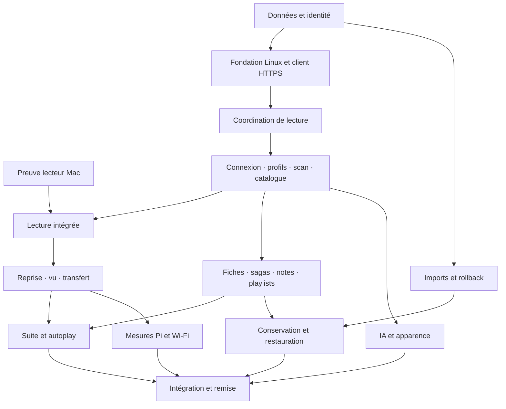

# Backlog Chill Center

Révision **CC-STORIES-001**, auteur /root, 2026-10-13 ; statut APPROVED_BY_USER. Entrées approuvées : [CC-FONC-002](discovery/SCOPE.md), [architecture CC-DOC-001](architecture/ARCHITECTURE.md) et [G-02 utilisateur](gates/G-02-CC-DOC-001.md). [G-03](gates/G-03-CC-STORIES-001.md) approuvé par « validé, go implémentation » ; implémentation IN_PROGRESS. Le présent changement de statut ne modifie ni stories, ni AC, ni DAG.

## Lecture et méthode

33 user stories fonctionnelles, neuf epics, 133 critères d'acceptation stables. Sept enablers et deux migrations sont séparés : 42 éléments du graphe, 128 points fonctionnels et 49 points techniques, soit 177 points relatifs. Ces points comparent l'effort/risque, pas des jours ou une date de livraison. Toutes les fonctionnalités validées restent Must Have ; les lots ordonnent le travail, ils ne retranchent pas le périmètre.

Le skill de découpage utilise ici le périmètre et l'architecture explicitement approuvés, conformément aux quatre étapes choisies par l'utilisateur, en lieu d'un PRD/gate PRD supplémentaire. Les stories décrivent valeur et résultats observables ; détails Rust/TLS/SQLite/FFI dans architecture et work-items. Une validation de stories n'est pas une preuve d'implémentation.

## Epics

| Epic | Domaine | Stories | Points |
| --- | --- | --- | --- |
| EPIC-001 | Accès et profils | US-001, US-002, US-003, US-004, US-005 | 17 |
| EPIC-002 | Catalogue commun | US-006, US-007, US-008, US-009, US-010, US-011, US-012 | 31 |
| EPIC-003 | Notes et playlists personnelles | US-013, US-014, US-015 | 11 |
| EPIC-004 | Lecteur Mac | US-016, US-017, US-018, US-019, US-020 | 18 |
| EPIC-005 | Reprise, vu et exclusivité | US-021, US-022, US-023 | 13 |
| EPIC-006 | Enchaînement | US-024, US-025 | 8 |
| EPIC-007 | Conservation et administration | US-026, US-027, US-028, US-029 | 18 |
| EPIC-008 | Organisation IA | US-030 | 5 |
| EPIC-009 | Apparence | US-031, US-032, US-033 | 7 |

## User stories

| ID | Fonction | Points | Depends On |
| --- | --- | --- | --- |
| [US-001](stories/US-001/story.md) | Choisir et connecter un serveur | 3 | ENABLER-002, ENABLER-003 |
| [US-002](stories/US-002/story.md) | Créer et renommer les profils du foyer | 3 | US-001, ENABLER-004 |
| [US-003](stories/US-003/story.md) | Choisir et retrouver son profil | 3 | US-002, ENABLER-005 |
| [US-004](stories/US-004/story.md) | Supprimer un profil sans toucher à la bibliothèque | 3 | US-003, ENABLER-005 |
| [US-005](stories/US-005/story.md) | Rester connecté lors du renouvellement du certificat | 5 | US-001 |
| [US-006](stories/US-006/story.md) | Indexer les vidéos du NAS | 5 | US-001, ENABLER-004 |
| [US-007](stories/US-007/story.md) | Parcourir et rechercher le catalogue | 5 | US-003, US-006 |
| [US-008](stories/US-008/story.md) | Explorer une série par saisons et épisodes | 3 | US-007 |
| [US-009](stories/US-009/story.md) | Corriger les informations du catalogue | 5 | US-007, US-008 |
| [US-010](stories/US-010/story.md) | Enrichir les fiches et personnaliser les affiches | 5 | US-009 |
| [US-011](stories/US-011/story.md) | Organiser les films en sagas communes | 5 | US-007, US-010 |
| [US-012](stories/US-012/story.md) | Gérer les références devenues indisponibles | 3 | US-006, US-007 |
| [US-013](stories/US-013/story.md) | Noter les vidéos avec son profil | 3 | US-007, US-008 |
| [US-014](stories/US-014/story.md) | Créer et remplir ses playlists | 5 | US-007 |
| [US-015](stories/US-015/story.md) | Réordonner une playlist | 3 | US-014 |
| [US-016](stories/US-016/story.md) | Lire une vidéo dans l'application Mac | 5 | US-003, US-007, ENABLER-001, ENABLER-003, ENABLER-005 |
| [US-017](stories/US-017/story.md) | Naviguer dans la vidéo | 3 | US-016 |
| [US-018](stories/US-018/story.md) | Configurer ses langues de lecture | 2 | US-003 |
| [US-019](stories/US-019/story.md) | Choisir audio et sous-titres dans le lecteur | 5 | US-016, US-018 |
| [US-020](stories/US-020/story.md) | Choisir et mémoriser la vitesse d'une série | 3 | US-016, US-008 |
| [US-021](stories/US-021/story.md) | Reprendre au dernier moment regardé | 5 | US-016, ENABLER-005 |
| [US-022](stories/US-022/story.md) | Marquer vu selon le visionnage final | 3 | US-021 |
| [US-023](stories/US-023/story.md) | Transférer la lecture entre appareils | 5 | US-021, ENABLER-005 |
| [US-024](stories/US-024/story.md) | Proposer la bonne vidéo suivante | 3 | US-008, US-011, US-015, US-016 |
| [US-025](stories/US-025/story.md) | Contrôler le lancement automatique | 5 | US-024, US-023 |
| [US-026](stories/US-026/story.md) | Retrouver l'historique après déplacement | 5 | US-006, US-013, US-014, US-021 |
| [US-027](stories/US-027/story.md) | Exporter les informations de sa bibliothèque | 3 | US-013, US-015, US-021, ENABLER-004 |
| [US-028](stories/US-028/story.md) | Importer les données de Cinéfolio ou Chill Center | 5 | US-027, MIG-001 |
| [US-029](stories/US-029/story.md) | Restaurer la bibliothèque depuis une sauvegarde | 5 | US-027, US-028, MIG-002 |
| [US-030](stories/US-030/story.md) | Organiser le catalogue avec l'IA | 5 | US-009, US-011, US-013, US-014, ENABLER-003 |
| [US-031](stories/US-031/story.md) | Choisir clair, sombre ou automatique | 2 | US-003 |
| [US-032](stories/US-032/story.md) | Activer les ambiances de saison et d'événement | 3 | US-031 |
| [US-033](stories/US-033/story.md) | Choisir ou désactiver une ambiance | 2 | US-032 |

Chaque story explicite aussi Blocks ; l'inverse des dépendances est calculé dans [dependencies.json](stories/dependencies.json). Les critères Given/When/Then ont un ID global US-NNN-AC-NN, sans recyclage.

## Travaux techniques et migrations

| ID | Travail | Points | Depends On |
| --- | --- | --- | --- |
| [ENABLER-001](work-items/ENABLER-001.md) | Prouver le lecteur Mac et le flux sécurisé | 8 | — |
| [ENABLER-002](work-items/ENABLER-002.md) | Préparer le service Linux et sa distribution | 3 | ENABLER-004 |
| [ENABLER-003](work-items/ENABLER-003.md) | Relier le client Mac au serveur en HTTPS | 5 | ENABLER-002 |
| [ENABLER-004](work-items/ENABLER-004.md) | Préparer le modèle partagé et personnel | 5 | — |
| [ENABLER-005](work-items/ENABLER-005.md) | Coordonner lecture, progression et transfert | 5 | ENABLER-002, ENABLER-003, ENABLER-004 |
| [MIG-001](work-items/MIG-001.md) | Exporter Cinéfolio et importer l'archive portable | 8 | ENABLER-004 |
| [MIG-002](work-items/MIG-002.md) | Assurer sauvegarde, migration et rollback | 5 | ENABLER-004 |
| [ENABLER-006](work-items/ENABLER-006.md) | Mesurer ressources et trois lectures sur le Pi | 5 | US-016, US-017, US-019, US-023, ENABLER-002 |
| [ENABLER-007](work-items/ENABLER-007.md) | Intégrer, distribuer et vérifier la version complète | 5 | US-001, US-002, US-003, US-004, US-005, US-006, US-007, US-008, US-009, US-010, US-011, US-012, US-013, US-014, US-015, US-016, US-017, US-018, US-019, US-020, US-021, US-022, US-023, US-024, US-025, US-026, US-027, US-028, US-029, US-030, US-031, US-032, US-033, ENABLER-006 |

Pas de nouvelle tâche SEC pour un défaut hypothétique : SEC-001 reste le risque de certificat accepté et tracé ; les contrôles LAN/TLS et limites sont intégrés aux enablers. Aucun bug Chill Center n'est prétendu corrigé.

## Ordre proposé d'implémentation

1. Prouver le lecteur Mac natif et le flux HTTPS (ENABLER-001) ; préparer les données (004). Ces pistes sont indépendantes. Échec du lecteur : diagnostic ou ADR de remplacement avant extension, pas un contournement TLS.
2. Fondation Linux, connexion Mac, coordination de lecture (002/003/005), puis connexion, profils, scan et catalogue. Préparer MIG-001/002 sur fixtures après 004.
3. Livrer un premier parcours complet : connecter le Mac, choisir un profil, voir un fichier du NAS, le lire, sauvegarder la reprise, atteindre le seuil vu et transférer proprement la lecture. Les cas de base ne remplacent pas les autres stories.
4. Compléter pistes, vitesses, notes, playlists/sagas, métadonnées et enchaînement suivant les dépendances exactes. Apparence et IA peuvent avancer indépendamment quand leurs prérequis existent.
5. Compléter réassociation, export/import et restauration ; comparer les historiques par profil et les données de source avant/après.
6. Mesurer deux puis trois lectures sur le Pi/Wi-Fi/NAS (006), puis intégration, packaging, smoke et remise finale (007). Le résultat n'est pas annoncé compatible avec trois flux sans cette preuve.

Le diagramme regroupe les domaines pour lecture ; [dependencies.json](stories/dependencies.json) est le DAG exact des 42 éléments, contrôlé pour identifiants manquants/cycles/inverses. Une dépendance exprime un préalable de code et de preuve, pas un gate utilisateur supplémentaire. Avant codage : contrats approuvés ; pour affirmer compatibilité des composants : code intégré ; pour affirmer lecture réelle : service exécuté et clients/NAS réels. Les mocks ne prouvent pas ce dernier état.

## Critère de remise de l'étape 4

Stories vérifiées sur leurs AC, dépendances intégrées, enablers/migrations avec preuves de sortie, aucun défaut critique inexpliqué, artefacts Linux/Mac identifiés par SHA et rollback documenté. Les mesures physiques encore non exécutées sont marquées NOT_RUN, pas transformées en DONE. Accès Pi/Linux, montage NAS et fichiers représentatifs seront nécessaires pour les preuves réelles ; aucune réinstallation ou restauration destructive réelle n'est implicitement autorisée.

## Revue et validation

[Rapport indépendant final](reviews/STORY_REVIEW_REPORT-r2.md) pour stories, AC, estimations, couverture et DAG ; [rapport initial conservé](reviews/STORY_REVIEW_REPORT.md). [Matrice des exigences](stories/TRACEABILITY.md) et [inputs/preuves](stories/INPUTS.md). Gate utilisateur G-03 approuvé ; [état de l'implémentation](implementation/STATUS.md). Ce dossier planifie la totalité de la première version Mac avec serveur Linux.

