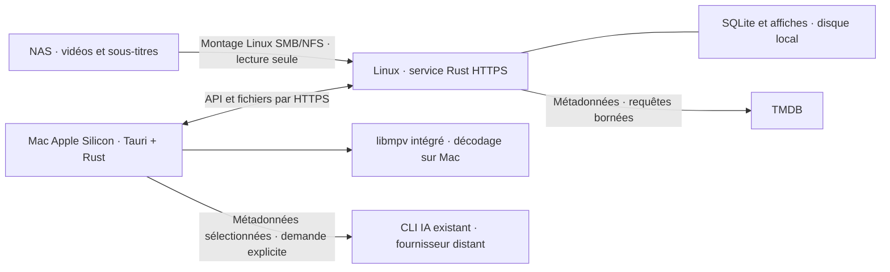

# Architecture Chill Center

Révision `CC-DOC-001`, statut `ACCEPTED`, auteur `/root`, 2026-10-13. Entrée fonctionnelle : [CC-FONC-002](../discovery/SCOPE.md). Validation utilisateur de l'étape 2 : [G-02](../gates/G-02-CC-DOC-001.md) ; marqueur de gouvernance seul actualisé, conception inchangée. Ce document n'est pas une preuve d'implémentation.

## 1. Vue d'ensemble

Le serveur lit les fichiers et envoie les octets demandés. Il ne décode, ne réencode ni ne produit des segments vidéo. Les sous-titres externes sont également servis par lui. Le client n'a aucun montage ni identifiant NAS. La base, les jaquettes et les certificats du serveur sont sur son disque local.

## 2. Découpage proposé

Workspace Rust avec `chill-domain` (règles, types, contrats), `chill-catalog` (scan, métadonnées, persistance), `chill-server` (API, TLS, flux, baux), `chill-client` (transport, confiance, réglages locaux, IA) et `chill-player` (adaptateur libmpv, événements). L'application Tauri utilise les deux derniers. Ce découpage est prévu, aucun crate créé à cette étape.

Réutiliser les parseurs, validations, transactions de collections, métadonnées et traitements d'affiches de Cinéfolio après extraction de leurs dépendances macOS. Remplacer les commandes Tauri qui touchent directement la base par des appels HTTPS via Rust. Retirer la dictée et l'ouverture externe du lecteur. Conserver l'interface HTML/CSS/JS sans ajouter un framework web ; porter les règles métier et le transport en Rust. « Maximum de Rust » n'impose pas de réécrire les codecs et la webview système : le décodage utilise une bibliothèque native éprouvée.

Linux proposé : Raspberry Pi OS Lite 64 bits, Debian 13, `aarch64-unknown-linux-gnu`. Un binaire Linux x86_64 peut utiliser les mêmes contrats ; Linux 32 bits n'est pas promis en première livraison. Rust stable 1.99.0 ; versions exactes des bibliothèques verrouillées avant build. [S-01/S-02](../SOURCES.md).

## 3. Service serveur

Axum/Tokio, terminaison HTTPS rustls, génération rcgen. Processus unique supervisé par systemd, utilisateur système dédié et non privilégié. Adresse d'écoute LAN explicitement configurée ; pas de découverte cloud, ouverture de routeur ou port Internet. Le montage SMB/NFS est assuré par Linux, en lecture seule. Les identifiants éventuels restent dans la configuration du montage, pas dans l'API ni l'export Chill Center.

Deux workers Tokio comme point de départ à mesurer ; file SQLite dédiée pour ne pas bloquer ces workers. Un scan à la fois ; les opérations NAS bloquantes se déroulent dans un sous-processus avec budget et annulation, comme le scanner existant. Une lecture noyau bloquée ne garantit pas un arrêt instantané : le serveur reste disponible et conserve le catalogue. Les scans partiels ou sources indisponibles ne provoquent aucune purge.

SQLite WAL sur stockage local, `foreign_keys=ON`, transactions brèves, délai d'attente borné. Lecture paginée et filtres côté serveur : ne pas envoyer tout le catalogue à chaque rafraîchissement. Les modifications communes portent une révision ; une écriture basée sur une ancienne révision est refusée, sans écraser les autres changements.

## 4. Vidéo et lecteur

HTTP Range (`206`, `Content-Range`, `416`) sur les fichiers indexés ; taille et version du fichier liées à l'ETag. Un lecteur peut demander plusieurs plages successives sans téléchargement intégral. Pas de compression HTTP pour les médias. Un changement de fichier pendant la lecture interrompt proprement la session pour éviter de mélanger deux contenus.

Le serveur reçoit un identifiant opaque, jamais un chemin arbitraire. Résoudre uniquement une entrée indexée dans une racine configurée ; refuser traversées, liens symboliques et changements de cible entre vérification et ouverture. Le chemin relatif peut rester visible dans une fiche comme dans Cinéfolio ; le chemin absolu serveur n'est pas une URL de lecture.

Moteur proposé : libmpv embarqué, piloté en Rust, cible VideoToolbox sur Apple Silicon lorsqu'elle est disponible ; repli logiciel signalé et mesuré. MKV/MP4/AVI sont des conteneurs, pas une garantie de tous les codecs qu'ils peuvent contenir. La matrice de tests portera sur des fichiers représentatifs et leurs véritables pistes. Le plein écran, le redimensionnement et les contrôles restent intégrés à l'application.

Le moteur n'ouvre pas lui-même une URL HTTPS avec une vérification différente. Un adaptateur `stream_cb` alimente libmpv depuis le transport Rust de confiance. Cette API est annoncée instable : version stable du moteur et ABI épinglées, client API ≥1.106 requis pour `cancel_fn`. Lectures/seeks bloquants restent hors UI/Tokio ; aucun appel libmpv depuis leurs callbacks. L'annulation réveille les IO sans bloquer et fait retourner des erreurs ; cookies refcountés jusqu'à `close_fn`, ressources conservées jusqu'à destruction effective du moteur. Pas de proxy HTTP local exposé ni de désactivation TLS globale. Rendu Mac, seek et arrêt pendant IO bloquée sont le premier enabler à prouver après validation des stories ; échec = ADR de remplacement avant intégration. Le bundle embarque les dépendances ; pas d'installation VLC requise. [S-06 à S-09](../SOURCES.md).

Les pistes audio/sous-titres sont découvertes côté Mac. Les sous-titres externes indexés par le serveur sont récupérés par HTTPS, avec taille bornée, puis fournis au moteur depuis un cache local contrôlé. Les fichiers adjacents portant le même nom de base et des suffixes de langue sont candidats ; en cas d'association ambiguë, proposer un choix explicite. La durée réelle provient du moteur, pas de la durée approximative TMDB.

## 5. Profils, reprise et exclusivité

Le catalogue et les sagas sont communs. Notes, playlists, reprises, statut vu et préférences de lecture référencent explicitement `profile_id`. Ce découpage empêche une erreur applicative de mélange ; il ne crée pas de confidentialité entre personnes du foyer puisque chacun peut choisir un profil.

Le serveur arbitre une seule session de lecture active par profil. Chaque bail est lié à `media_id` et `media_revision`. Bail proposé : 30 s, renouvellement toutes les 5 s. Les événements et flux comportent cette liaison, session, génération et séquence ; les anciennes générations ne peuvent plus écrire ni récupérer des octets. Toute nouvelle vidéo, y compris enchaînée, reçoit une génération nouvelle et invalide atomiquement les événements/flux de la précédente. Les baux deviennent invalides après redémarrage du serveur. [Contrat de transfert](CONTRACTS.md#transfert-de-lecture).

Transfert : confirmation sur le nouveau Mac, demande de pause à l'ancien, révocation de ses flux, réception de sa position finale, puis activation du nouveau bail. L'entrée en `TRANSFERRING` fige l'échéance de l'ancien bail ; ses heartbeats ne peuvent plus la prolonger. Un seul ACK final, lié à cette génération et ce média, est accepté avant l'échéance puis le bail est clos atomiquement. Si l'ancien est inaccessible, attendre cette échéance avant d'activer le nouveau : son client officiel se met en pause à échéance même avec tampon. Une révocation HTTP seule ne peut pas arrêter une vidéo déjà en mémoire.

Pause et fermeture envoient la position puis libèrent le bail ; reprendre requiert de le réacquérir. Changer de profil fait de même. Une demande en attente ou un vieux paquet ne peut pas modifier la reprise du profil devenu actif. Les clients non coopératifs ne peuvent pas être empêchés de rejouer des octets déjà reçus ; cette limite appartient au périmètre sans authentification/DRM.

Position persistée au plus toutes les 5 s pendant lecture, immédiatement après pause, seek et arrêt ; en cas de coupure brutale, la reprise peut perdre environ ce dernier intervalle. Le serveur utilise sa génération/séquence pour ordonner les événements, pas l'horloge du Mac. Hors connexion, une ancienne position ne sera pas rejouée automatiquement au détriment d'une nouvelle session.

Marquage vu : cumuler les secondes réelles de lecture, uniquement lorsque la position est dans `[0,9 × durée, durée]`. Exclure pauses, buffering et sauts ; ×2 ne transforme pas 5 secondes réelles en 10. Cumul par profil/vidéo proposé, persistant entre sessions ; l'utilisateur n'a pas demandé dix secondes consécutives. Les vidéos très courtes restent soumises à cette même règle et au marquage manuel. Si la durée est inconnue, ne pas inventer le seuil. Le serveur valide les bornes et incréments crédibles ; il ne peut prouver une attention humaine à partir d'une requête vidéo.

## 6. Enchaînement et préférences

Contexte de lecture fixé au lancement : playlist et sa révision, saga et son ordre, ou série. Une fiche de film isolée fournit `standalone`. Séries triées par saison/épisode, inconnus sans suite automatique ; changement de saison signalé. Sagas : ordre du catalogue, par défaut année/titre hérité ; playlist : ordre personnel. Une collection modifiée pendant lecture entraîne une résolution de la suite sur sa nouvelle révision, pas l'utilisation silencieuse d'une liste périmée.

À `ended`, arrêter le compteur, enregistrer la position et libérer le bail, puis résoudre la vidéo suivante et sa disponibilité. Montrer vignette/titre et boutons ; 10 s par défaut. Le compte à rebours démarre après affichage des informations. Désactivation = proposition sans compteur ; 0 s = lancement immédiat si disponible. Avant lancement, vérifier disponibilité et acquérir une nouvelle génération liée au média suivant. Si un autre appareil a acquis le profil entre-temps, annuler l'autoplay et demander confirmation du transfert ; aucun transfert automatique forcé. « Ne pas lancer » annule cette proposition sans changer le réglage. Aucun lancement sur erreur de lecture ou changement de profil.

Vitesses autorisées : 0,5/0,75/1/1,25/1,5/1,75/2. Hors série, chaque nouvelle vidéo commence à ×1 ; changer la vitesse reste possible pour la lecture courante. En série, stocker le choix sous `(profile_id, series_id)`, y compris le retour à ×1. Préférences audio et sous-titres distinctes, anglais initial ; fallback validé en F-11, sans changer la préférence enregistrée. Plein écran et contrôles accessibles au clavier sont proposés comme exigences techniques de qualité du lecteur, sans ajouter de contrôle vocal.

## 7. Confiance HTTPS

Identité stable `server_id`, magasin local des serveurs approuvés, alias DNS/IP, certificat et empreinte SPKI de sa clé publique. À la première connexion : montrer adresse et empreinte avant acceptation ; aucune requête de profil ou vidéo avant ce choix. Le pin porte sur la clé, pas seulement les octets du certificat.

Créer le premier certificat au démarrage initial, validité 18 mois calendaires ; renouveler à l'anniversaire des 12 mois avec la même clé de service, vérifier au démarrage et quotidiennement. Serveur éteint : renouvellement au redémarrage si nécessaire. Horloge Linux fiable requise. Le certificat contient les DNS/IP configurés ; modifier une adresse est une opération explicite. Le serveur persiste le calendrier et remplace le certificat atomiquement sans envoyer sa clé privée.

Renouvellement normal : le verifier Rust compare directement au handshake la SPKI présentée à la clé approuvée, puis contrôle SAN, période, structure du certificat et signatures TLS. Si la clé correspond, le client accepte le nouveau certificat et actualise sa validité connue ; aucun accès HTTP préalable ni maintien de l'ancien certificat n'est nécessaire. API, fichiers et lecteur partagent ce même verifier. Un certificat lui-même expiré reste refusé, même si sa clé correspond.

Clé différente et ancien certificat connu expiré : accepter automatiquement le nouveau pour cette entrée de serveur, conformément au choix utilisateur, puis enregistrer le nouveau pin. Cette exception ne prouve pas l'identité de l'émetteur ; substitution possible sur un LAN compromis. Enregistrer un événement visible. Si la clé change alors que l'ancien est encore valide, demander acceptation explicite. Jamais confiance globale ; toujours contrôler format, période du nouveau, SAN et signatures TLS. La clé conservée à long terme doit être protégée (`0600`, compte de service) et sauvegardée séparément. Perte/compromission : remplacement explicite avec réapprobation des clients tant que leur ancien certificat est valide ; pas attendre l'expiration pour une intervention d'urgence. [ADR-0005](decisions/ADR-0005-https.md).

## 8. Bibliothèque, import et identité des médias

Attribuer des UUID stables aux médias, séries et collections. Le chemin relatif devient une localisation, pas l'identité. Un changement de racine conserve les références via correspondance explicite ; un scan ne réinitialise jamais notes, reprises ou playlists.

Pour un déplacement non déclaré, utiliser taille et empreinte partielle échantillonnée pour proposer des correspondances. Lire au plus un fichier à la fois en arrière-plan, ≤1 MiB/s, et suspendre ces lectures pendant la vidéo. Une empreinte partielle n'est pas une preuve d'identité : la réassociation automatique exige une empreinte complète déjà connue ou une identité de fichier démontrée stable sur ce montage. Sinon l'administrateur confirme une proposition ; les données restent attachées à l'ancien UUID jusque-là. Plusieurs candidats ne sont jamais fusionnés par leur titre. Ce compromis conserve l'historique sans imposer de hash intégral de chaque vidéo sur le Wi-Fi.

Export ZIP : `manifest.json`, données JSON versionnées, affiches référencées par empreinte ; notes/reprises/playlists avec leurs profils. Pas de vidéos, jetons TMDB, identifiants NAS, clés TLS ou sessions actives. Sauvegarde opérationnelle des secrets = procédure Linux distincte, pas export familial.

Import Cinéfolio : outil d'export lisant une copie cohérente de sa base, mapping des anciens chemins aux UUID, métadonnées/sagas communes, notes/vus/playlists vers un profil choisi. Pas d'écriture dans la base d'origine. Un import répété reconnu par `export_id` ne duplique pas les éléments ; nouvelle révision = aperçu de conflits, aucune fusion personnelle implicite. Valider archive, limites, liens, collisions et racines avant transaction ; refus entier si invalide. Les affiches sont d'abord préparées, puis la transaction associe les fichiers validés. Une restauration remplaçante exige sauvegarde préalable et arrêt des lectures ; l'import ordinaire n'écrase pas automatiquement toute la base.

## 9. IA et apparence

CLI Codex/Claude exécuté à la demande sur le Mac, connecté par l'utilisateur comme dans Cinéfolio ; aucun modèle local sur le Pi ni exécutable choisi par un profil côté serveur. Les commandes exactes seront vérifiées avant réutilisation. Cache de travail isolé, limites existantes et timeout conservés. Envoyer seulement les métadonnées nécessaires et l'état du profil actif, avec identifiants temporaires ; pas d'autres profils, vidéos, chemins ou secrets. Le fournisseur externe reçoit ces métadonnées quand l'utilisateur lance l'IA.

Le Mac prévisualise un plan. Le serveur valide de nouveau types, UUID, profil et révisions, puis applique transactionnellement après confirmation. Les changements partagés sont identifiés dans l'aperçu. Un résultat obtenu pour un ancien profil est périmé après changement de profil. Le petit bouton « IA » demeure accessible au clavier ; pas de dictée.

L'apparence est locale au Mac : clair/sombre/système indépendamment de l'ambiance auto/manuelle/désactivée. Calendrier F-21 dans le fuseau local de l'appareil, événements prioritaires, vérification au démarrage, réveil et passage de date ; pas de polling permanent. Palette et illustrations statiques, respect du contraste et de la réduction des animations. Pas de télémétrie externe ajoutée.

## 10. Ressources et exploitation

Mise à jour ciblée demandée par l'utilisateur14octobre2026 : le **budget de cache client64 Mio du paragraphe historique ci-dessous est remplacé** par [ADR-0010](decisions/ADR-0010-client-playback-cache.md), cible60 s avant/retour approximatif30 s, défaut128/64 Mio, configurable par Mac16–512/0–256 Mio. La révision est PROPOSED en attente de revue exacte, implémentation en cours ; les anciennes mesures client ne l'approuvent pas. Les autres seuils serveur de CC-DOC-001 restent inchangés. Le paragraphe initial est conservé pour traçabilité, pas comme deuxième plafond normatif actuel.

Objectifs proposés, à mesurer et non acquis : RSS serveur ≤100 MiB au repos avec 3 000 vidéos et ≤200 MiB pendant trois lectures hors scan ; CPU au repos ≤2 % d'un cœur sur 60 s ; cache vidéo Mac plafonné à 64 MiB par lecture ; buffers serveur ≤1 MiB par flux ; page de catalogue 100 éléments maximum. Le RSS n'inclut pas le cache disque du noyau : mesurer aussi la mémoire système disponible et les processus de scan. RSS client incluant webview/moteur à mesurer avant de fixer un seuil crédible.

Files de travaux bornées, téléchargement d'affiches deux à la fois, fingerprint/maintenance suspendus pendant vidéo. Aucun préchargement complet du prochain épisode ; sa jaquette seule peut être préparée. Le buffering améliore les pointes de débit mais ne corrige pas un débit moyen insuffisant. Exemple hypothétique : trois flux à 8 Mb/s représentent environ 24 Mb/s reçus du NAS et autant envoyés par le Pi, avant frais réseau. Ne pas promettre de qualité adaptative serveur.

Logs structurés : codes d'erreur, durées, compteurs et identifiants opaques ; ni secrets, prompts, chemins absolus ni noms de profils. Logs tournants bornés, conservation proposée sept jours. Console Administration : état du scan, montage disponible, lectures actives et diagnostics de débit. Elle n'a pas de protection d'accès supplémentaire dans cette version.

Livraison future : binaire Linux release, configuration et unité systemd ; application `.app` Mac avec dépendances embarquées. Ne pas compiler la pile Mac sur le Pi ; cross-build ou runner Linux ARM64 avec contrôle réel final sur Pi. Sauvegarde SQLite cohérente, configuration et secrets sauvegardés séparément avec droits restreints. Chaque migration a une sauvegarde pré-migration ; retour ancien binaire seulement avec schéma compatible, sinon restauration de cette sauvegarde. Les vidéos restent intactes. [Vérification prévue](../VERIFICATION.md).
