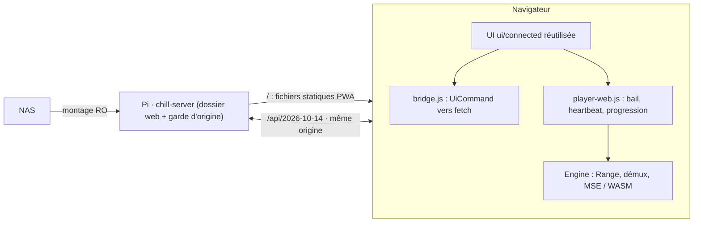

# Client web (PWA) Chill Center

Révision `CC-WEB-001`, statut `PROPOSED` ([ADR-0012](decisions/ADR-0012-web-client-pwa.md)), 2026-10-14, branche `codex/web-pwa`. Ce document décrit la cible et l'état réel ; ce n'est pas une preuve de livraison.

## Vue d'ensemble

Démux, décodage, rendu, sous-titres, cache de lecture et horloge de visionnage s'exécutent dans le navigateur. Le serveur lit des octets et applique les règles d'état (baux, vu, révisions).

## Correspondance avec le client Mac

| Fonction Mac | Web | État |
| --- | --- | --- |
| Connexion + approbation SPKI | Même origine ; certificat géré par le navigateur | Pont implémenté |
| Profils, préférences, catalogue, fiches, notes, vu, séries, sagas, playlists | Passthrough REST du pont | Implémenté, tests Node |
| Affiches | `fetch` → object URL | Implémenté |
| Thème, ambiances F-21 | JS existant, `localStorage` | Implémenté |
| Cache de lecture ADR-0010 | Plafonds sur le tampon MSE | Réglages stockés ; application à faire |
| Bail, heartbeat 5 s, progression, `WatchClock`, enchaînement | `player-web.js`, `watch-clock.js` | Implémenté, testé avec moteur factice |
| Lecture MP4 fragmenté (MSE direct) | `engines/mse.js` | Implémenté, **non essayé sur vraie vidéo** |
| Lecture MKV/AVI, AC-3/DTS, HEVC, ASS | Démux/décodage WASM | **Non démarré** : spike + ADR |
| Transfert confirmé de lecture, SSE | `player-web.js` | À faire |
| Admin : bibliothèque, profils, scan, préférences | Pont | Implémenté |
| Admin : TMDB, archives, identité | Appels API identiques | Non porté |
| IA | — | Hors périmètre web |
| PWA installable | manifest + Service Worker | Implémenté ; dépend de la confiance TLS |

## Contraintes d'API respectées

Base `/api/2026-10-14`. `GET /server` est lu au démarrage et le client refuse un serveur qui n'annonce pas `catalog_pages`, `playback_leases`, `media_range`. Corps stricts, réponses tolérantes. `media_revision` est conservé exactement (`web/src/json64.js`). Un seul `Range`, `ETag` mémorisé puis `If-Match`. En-têtes `X-Chill-Session`/`X-Chill-Generation` jamais en URL. Aucun appel `/admin/*` sans action explicite.

## Build et déploiement

`node scripts/build-web.mjs` copie `ui/connected` dans `web/dist`, retire les modules `*-qa.js` et tests, injecte le pont, le Service Worker et le manifest. `web/dist` est destiné au dossier `<data_dir>/web` du Pi (lecture seule pour le compte de service). **Aucun déploiement effectué** : il exige une autorisation explicite.

## Risques ouverts

1. Lecture MKV/AVI en navigateur : remux JS + WASM, performances Wi-Fi/CPU, taille ; à mesurer avant d'annoncer la parité (F-22).
2. Certificat autogénéré : Service Worker et installation PWA souvent refusés sans approbation système.
3. Safari/iOS : MSE limité ; non évalué.
4. Garde d'origine fondée sur `Sec-Fetch-Site` ; à valider sur les navigateurs cibles.
5. Build Rust non exécuté ici (`cargo` absent) : le delta serveur est NOT_RUN.

## Vérifications exécutées (14 octobre 2026, branche `codex/web-pwa`)

| Vérification | Résultat |
| --- | --- |
| `node --test web/test/*.test.js` : pont (catalogue, profils, erreurs, calendrier, cache), JSON 64 bits, `WatchClock`, contrôleur de lecture avec moteur factice | 17/17 PASS |
| `node scripts/build-web.mjs`, UI Mac chargée dans le navigateur intégré contre une API **factice** locale (HTTP, 3 fiches) : connexion, choix de profil, grille catalogue, aucune erreur console | PASS (aperçu visuel seul) |
| Rust : garde d'origine, service statique, tests ajoutés (`api.rs`, `web_static.rs`) | **NOT_RUN** — `cargo` absent ; code non compilé |
| Vrai serveur Pi, TLS réel, vraie vidéo, Service Worker sur certificat autogénéré | **NOT_RUN** |

Ces résultats ne valident ni la lecture MKV/AVI, ni le débit sur Wi-Fi, ni le déploiement.
