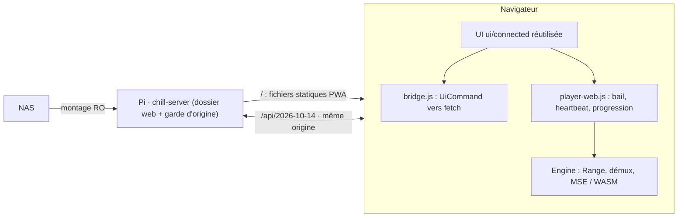

# Client web (PWA) Chill Center

Révision `CC-WEB-001`, statut `PROPOSED` ([ADR-0012](decisions/ADR-0012-web-client-pwa.md)), 2026-10-14, branche `codex/web-pwa`. Ce document décrit la cible et l'état réel ; ce n'est pas une preuve de livraison.

## Vue d'ensemble

Démux, décodage, rendu, sous-titres, cache de lecture et horloge de visionnage s'exécutent dans le navigateur. Le serveur lit des octets et applique les règles d'état (baux, vu, révisions).

## Correspondance avec le client Mac

| Fonction Mac | Web | État |
| --- | --- | --- |
| Connexion + approbation SPKI | Même origine ; certificat géré par le navigateur | Pont implémenté |
| Profils, préférences, catalogue, fiches, notes, vu, séries, sagas, playlists | Passthrough REST du pont | Implémenté, tests Node |
| Affiches | `fetch` → object URL | Implémenté |
| Thème, ambiances F-21 | JS existant, `localStorage` | Implémenté |
| Cache de lecture ADR-0010 | Plafonds sur le tampon MSE | Réglages stockés ; application à faire |
| Bail, heartbeat 5 s, progression, `WatchClock`, enchaînement | `player-web.js`, `watch-clock.js` | Implémenté, testé avec moteur factice |
| Lecture MP4/MOV (codecs au choix du navigateur : H.264, HEVC, VP9, AV1, AAC, Opus…) | `mp4.js` (démux + remux fMP4 en JS pur), `range-reader.js`, `mse-engine.js` ; le navigateur décode ([ADR-0013](decisions/ADR-0013-web-playback-engine.md)) | Implémenté ; vérifié sur fichier généré VP9/Opus, **pas encore sur un fichier réel du NAS ni sur le Pi** |
| Lecture MKV/WebM | `mkv.js` : démuxeur EBML en JS pur (Cues pour les sauts, sinon parcours des en-têtes de clusters ; laçage Xiph/EBML/fixe ; réordonnancement des B-frames en flux) | Implémenté ; vérifié sur fichiers générés (H.264/AAC avec B-frames, VP9/Opus), **pas encore sur un MKV réel du NAS** |
| Lecture AVI | À décider après inventaire des codecs réels | **Non démarré** |
| AC-3/E-AC-3/DTS, MPEG-4 ASP, ASS complet | Non décodés par le navigateur : piste alternative sinon message ; aucun WASM sans ADR | Limite assumée |
| Transfert confirmé de lecture, SSE | `player-web.js` | À faire |
| Admin : bibliothèque, profils, scan, préférences | Pont | Implémenté |
| Admin : TMDB, archives, identité | Appels API identiques | Non porté |
| IA | — | Hors périmètre web |
| PWA installable | manifest + Service Worker | Implémenté ; dépend de la confiance TLS |

## Contraintes d'API respectées

Base `/api/2026-10-14`. `GET /server` est lu au démarrage et le client refuse un serveur qui n'annonce pas `catalog_pages`, `playback_leases`, `media_range`. Corps stricts, réponses tolérantes. `media_revision` est conservé exactement (`web/src/json64.js`). Un seul `Range`, `ETag` mémorisé puis `If-Match`. En-têtes `X-Chill-Session`/`X-Chill-Generation` jamais en URL. Aucun appel `/admin/*` sans action explicite.

## Build et déploiement

`node scripts/build-web.mjs` copie `ui/connected` dans `web/dist`, retire les modules `*-qa.js` et tests, injecte le pont, le Service Worker et le manifest. `web/dist` est destiné au dossier `<data_dir>/web` du Pi (lecture seule pour le compte de service). **Aucun déploiement effectué** : il exige une autorisation explicite.

## Risques ouverts

1. Lecture AVI en navigateur à justifier ; MKV à confirmer sur de vrais fichiers ; codecs réellement présents dans la bibliothèque à inventorier avant d'annoncer la parité (F-22).
2. Certificat autogénéré : Service Worker et installation PWA souvent refusés sans approbation système.
3. Safari/iOS : MSE limité ; non évalué.
4. Garde d'origine fondée sur `Sec-Fetch-Site` ; à valider sur les navigateurs cibles.
5. Build Rust non exécuté ici (`cargo` absent) : le delta serveur est NOT_RUN.

## Vérifications exécutées (14 octobre 2026, branche `codex/web-pwa`)

| Vérification | Résultat |
| --- | --- |
| `node --test web/test/*.test.js` : pont, JSON 64 bits, `WatchClock`, contrôleur de lecture (moteur factice), lecteur `Range`, démuxeurs MP4 et MKV sur fichiers ffmpeg (H.264/AAC avec B-frames, VP9/Opus, `moov` en fin de fichier) dont fMP4 reconstruit décodé sans erreur par ffmpeg | 32/32 PASS (ffmpeg requis pour les tests MP4/MKV) |
| Lecture réelle dans le navigateur intégré, contre un serveur factice servant en `Range` un MP4 VP9/Opus, un MKV VP9/Opus et un MKV H.264 (3 B-frames)/AAC de 40 s : bail, `If-Match`, saut +30 s, vitesse ×1,5, saut hors tampon, retour arrière, tampon borné (~20 s), fin de vidéo, libération du bail, révision 64 bits exacte | PASS |
| `node scripts/build-web.mjs`, UI Mac chargée dans le navigateur intégré contre une API **factice** locale (HTTP, 3 fiches) : connexion, choix de profil, grille catalogue, aucune erreur console | PASS (aperçu visuel seul) |
| Rust : garde d'origine, service statique, tests ajoutés (`api.rs`, `web_static.rs`) | **NOT_RUN** — `cargo` absent ; code non compilé |
| Vrai serveur Pi, TLS réel, vraie vidéo, Service Worker sur certificat autogénéré | **NOT_RUN** |

Ces résultats ne valident ni l'AVI, ni un fichier réel du NAS, ni le débit sur Wi-Fi, ni le déploiement.

## Essai sur le Pi (lecture seule)

Voir [WEB-PI-READONLY-EVIDENCE](../implementation/WEB-PI-READONLY-EVIDENCE.md) : 21 fichiers réels ouverts par les démuxeurs, inventaire du catalogue (MKV 78 %, AVI 15 % tous Xvid dans l'échantillon, MP4 7 %), AC-3 fréquent. LAVI