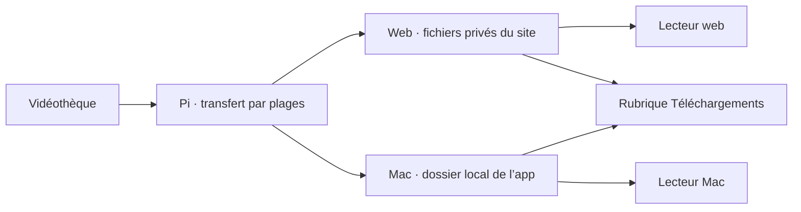

# ADR-0046 — Téléchargements et lecture hors connexion

21 novembre 2026 · Architecture proposée, en attente de validation.
Le [périmètre fonctionnel](../../discovery/OFFLINE-DOWNLOADS.md) est approuvé,
avec **Supprimer après visionnage** activé par défaut. Cette décision complète
les ADR du client web et du lecteur natif et prolonge F-03, F-06 à F-08 et F-22.
Le client conserve une copie exacte de la vidéo. L’architecture utilise les
lecteurs et les décodeurs déjà présents dans Chill Center.

## Parcours et responsabilités

La fiche vidéo, saison ou série envoie une sélection. Le serveur la résout
avec les identifiants et les règles de disponibilité du catalogue. La file
télécharge un élément à la fois par appareil, ignore les copies complètes
de la même version et indique le progrès, l’annulation et les échecs par
élément. La demande d’une saison ou d’une série affiche la quantité à copier
avant démarrage. Une sélection mixte laisse les copies réussies disponibles
et permet de reprendre les échecs.

L’interface partagée affiche **Téléchargements** sous les autres catégories
dès qu’une copie existe pour le profil actif. Films et séries sont les seules
entrées à la racine. Une série expose ses saisons et épisodes téléchargés.
La navigation locale, le changement entre profils déjà connus sur cet
appareil, l’état vu et la reprise locale fonctionnent aussi quand le serveur
est éteint. Les profils et données d’une autre identité serveur restent
distincts, y compris si son adresse est réutilisée.

## Transfert depuis le Pi

Ajouter une capacité de téléchargement au contrat d’API existant. Elle fournit
la liste bornée et paginée des vidéos, leurs tailles et versions, les éléments
de présentation nécessaires hors ligne, ainsi que les sous-titres externes
pris en charge. Les réponses utilisent les identifiants stables du catalogue.
Les chemins NAS et chemins locaux restent internes. Un ancien serveur n’affiche
pas l’action **Télécharger**. Les copies déjà enregistrées restent utilisables.

Créer des sessions de transfert indépendantes des baux de lecture. Un transfert
ne change ni le lecteur actif du profil ni sa progression. Chaque session est
courte et renouvelable. Le serveur la lie au profil, à la vidéo et à sa version.
Il applique les vérifications de même origine du LAN et les contrôles de
chemins et de révision des lectures en ligne. Il transmet des plages bornées
depuis le fichier déjà indexé. Une limite globale de deux transferts et une
limite par appareil bornent les descripteurs, la mémoire et la charge du Pi.
Les transferts figurent dans l’état de maintenance comme travaux actifs.
Leur annulation libère les ressources.

Le client écrit dans une zone partielle et étiquette chaque copie avec la
révision et la taille attendues. Une reprise réutilise les octets déjà reçus
seulement si le serveur confirme la même version et le même validateur. Le
client vérifie les plages, leur longueur et la taille finale avant publication.
Les fichiers externes et l’affiche sont rangés avec la copie. Une absence
d’affiche n’empêche pas de lire. Un sous-titre externe annoncé mais indisponible
est signalé et peut être repris séparément.

## Stockage et lecture web

Stocker les octets dans l’espace privé de l’origine (OPFS) et le catalogue
local compact dans IndexedDB. Un worker écrit par blocs de taille bornée.
Chaque copie a une clé opaque sous l’identité serveur et le profil. Après
écriture, fermeture et contrôle de taille, la transaction IndexedDB marque
la copie prête. Un verrou exclusif par copie coordonne téléchargement,
réparation et suppression entre onglets. Après interruption, seules les
copies prêtes dont les fichiers existent sont listées. L’application reprend
ou efface les données partielles qu’elle identifie comme telles.

Le service worker existant doit mettre en cache la coque versionnée et les
codecs locaux nécessaires aux vidéos enregistrées, y compris les workers et
fichiers WASM aujourd’hui chargés à la demande. La navigation essaie le serveur
avec un délai borné et charge la coque locale en cas d’échec de transport
ou d’indisponibilité temporaire. La mise à jour de la coque prépare toutes
les ressources avant activation et garde la version précédente utilisable
par les onglets déjà ouverts.
L’amorçage local lit le dernier profil connu et ouvre Téléchargements sans
attendre un appel à l’API. Un lecteur par plages OPFS est passé au moteur web
existant et permet de conserver les sauts, la lecture HEVC ou MP4 prise en
charge et les pistes de sous-titres. Les médias sont lus depuis OPFS,
hors du cache HTTP et sans assemblage complet en mémoire.

L’action de téléchargement exige une origine HTTPS reconnue, un service worker
actif, OPFS et une coque hors ligne complète. Le téléchargement ne démarre que lorsque la préparation est vérifiée dans
le navigateur. L’interface signale le prérequis manquant lorsque le navigateur
l’identifie. Une page déjà préparée peut ouvrir ses copies locales après un
échec réseau, sans envoyer de nouveaux progrès jusqu’à la confirmation du
serveur de confiance. Les téléchargements restent
attachés au profil de navigateur et à l’origine exacte. On demande le stockage
persistant et on gère le refus ou l’effacement par le navigateur. Pour la
capacité, afficher la taille réelle des fichiers enregistrés et
`max(0, quota - usage)` / `quota` comme estimation pour le site. Masquer les
chiffres indisponibles avec un libellé explicite.

Références : [Service Workers et contexte sécurisé](https://www.w3.org/TR/secure-contexts/),
[OPFS dans WebKit](https://webkit.org/blog/12257/the-file-system-access-api-with-origin-private-file-system/),
[quota et persistance](https://webkit.org/blog/14403/updates-to-storage-policy/).

## Stockage et lecture Mac

Le backend Rust conserve l’index SQLite et les fichiers dans le dossier de
données local de Chill Center. Il écrit dans des fichiers partiels, les ferme
après vérification et publie une entrée prête seulement après promotion de la
copie. L’interface Tauri manipule des identifiants et reçoit les progrès et
tailles. Le backend résout les chemins sous sa racine, en refusant les liens
symboliques et les entrées inattendues. Le lecteur natif lit la source locale
et charge les pistes externes copiées, sans exposer un chemin arbitraire à la
webview. Le stockage affiche les octets des copies et l’espace libre et total
du volume qui les contient. L’application peut ouvrir son dossier de
téléchargements dans le Finder.

Au lancement, le backend réouvre l’index local avant la connexion au serveur.
Les fichiers supprimés via Finder sont repérés par surveillance du dossier,
et vérifiés à l’ouverture de la rubrique, au retour au premier plan et avant
chaque lecture. Sur le web, les mêmes vérifications se font via OPFS à
l’ouverture, au retour au premier plan et pendant l’affichage de la rubrique.
Un fichier manquant retire la vidéo de l’index visible. Une erreur de permission
ou de lecture reste distincte d’une absence. Les tailles sont recalculées à
partir des copies présentes, y compris leurs sous-titres.

Référence : [capacité d’un volume sur macOS](https://developer.apple.com/documentation/foundation/checking-volume-storage-capacity).

## Progression, conflits et suppression

Depuis Téléchargements, le lecteur ouvre la copie locale. Tant que le serveur
est joignable, la lecture respecte le bail existant et envoie ses progrès
normalement. Une perte de transport permet de continuer sur les octets locaux.
Un conflit de bail explicite continue de proposer le transfert. Au démarrage
sans réseau, les points de reprise sont écrits dans un journal local durable.
Les copies complètes et leur état vu restent utilisables, même après
redémarrage du Mac ou fermeture du navigateur.

À la reconnexion avec la même identité et le même profil, synchroniser les
progrès locaux à partir de la dernière révision connue par média. Le serveur
enregistre la mise à jour conditionnelle et son identifiant d’idempotence
dans la même transaction. En présence d’un bail actif ou en l’absence d’une
révision de référence, garder la progression locale en attente. Si la révision a avancé ailleurs, garder l’état serveur et
laisser visible la reprise locale dans Téléchargements. Une vidéo retirée
du catalogue ou un profil supprimé ne doit pas recréer d’état serveur. Les
sessions locales ne rejouent pas de requêtes de heartbeat ou de baux expirés.
Le serveur distingue un visionnage déclaré hors connexion de la progression
mesurée pendant un bail actif. La mise à jour conditionnelle est soumise aux
mêmes contrôles de profil et de média que les écritures existantes. Les conflits se résolvent par révision, indépendamment de
l’horloge de l’appareil.

**Supprimer après visionnage** est activé par défaut pour chaque nouvelle copie.
L’utilisateur peut désactiver l’option par vidéo. Une lecture confirmée jusqu’à
la fin applique la règle de visionnage réel du dernier dixième et la règle
existante des vidéos courtes. Un média déjà vu au téléchargement, un saut à
la fin ou un marquage manuel n’est pas un déclencheur. La progression et la
décision sont enregistrées avant d’effacer. La suppression attend la fermeture
des lecteurs ouverts sur la copie. En cas d’échec, la copie reste visible avec
une action de réessai. Une opération interrompue est réconciliée au redémarrage.

La suppression manuelle et automatique cible uniquement la copie gérée
localement et ses fichiers annexes. La corbeille du Finder n’est pas utilisée
pour la suppression automatique, afin que l’espace soit libéré. Le catalogue,
la source du Pi et les autres appareils sont préservés. La rubrique disparaît
lorsque sa dernière copie prête disparaît.

## Vérification avant livraison

- Télécharger film, saison et série, annuler au milieu et reprendre une copie
  tronquée, vérifier dossiers pleins, doublons, changements de révision et
  coordination entre deux onglets.
- Relancer chaque client à froid avec serveur inaccessible. Lire et chercher
  dans un MP4, un MKV avec sous-titres intégrés et une vidéo avec sous-titre
  externe. Couvrir un codec web chargé à la demande et le plein écran.
- Effacer un fichier via Finder et effacer les données du site, puis vérifier
  la disparition des entrées et la cohérence des tailles. Vérifier la
  persistance et l’échec propre en cas de quota insuffisant.
- Vérifier la suppression après lecture réelle, sa désactivation, les sauts,
  les marqueurs manuels, les vidéos déjà vues et une copie encore ouverte.
- Vérifier l’isolation des profils et serveurs, le refus des chemins arbitraires,
  l’absence d’écritures NAS, et les conflits de reprise après reconnexion.
- Valider le démarrage web à l’adresse HTTPS réelle dans les navigateurs ciblés,
  dont Safari sur iPhone et Chrome sur Android. Valider un véritable
  redémarrage de l’application sur Mac. Ces essais restent à faire au stade
  de cette proposition.
