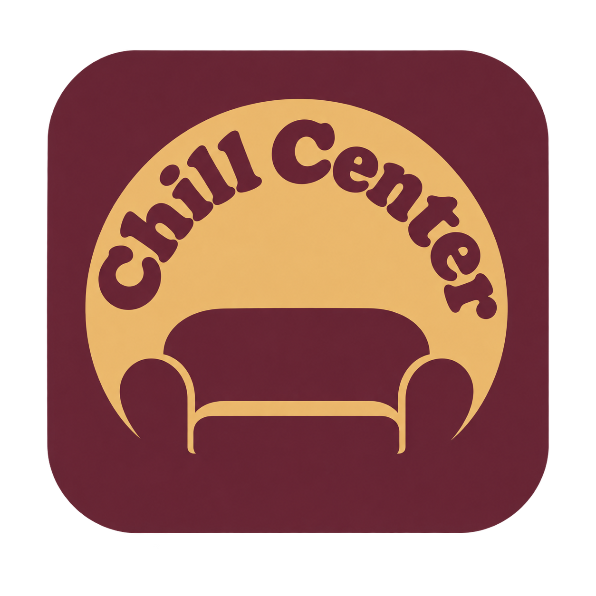
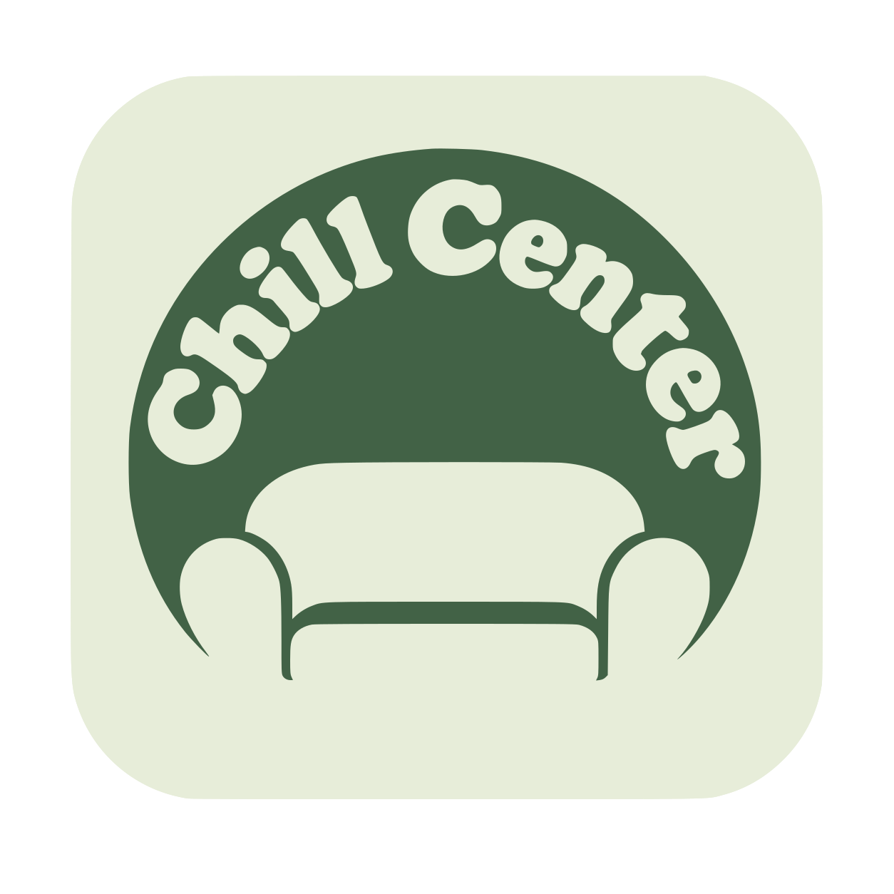
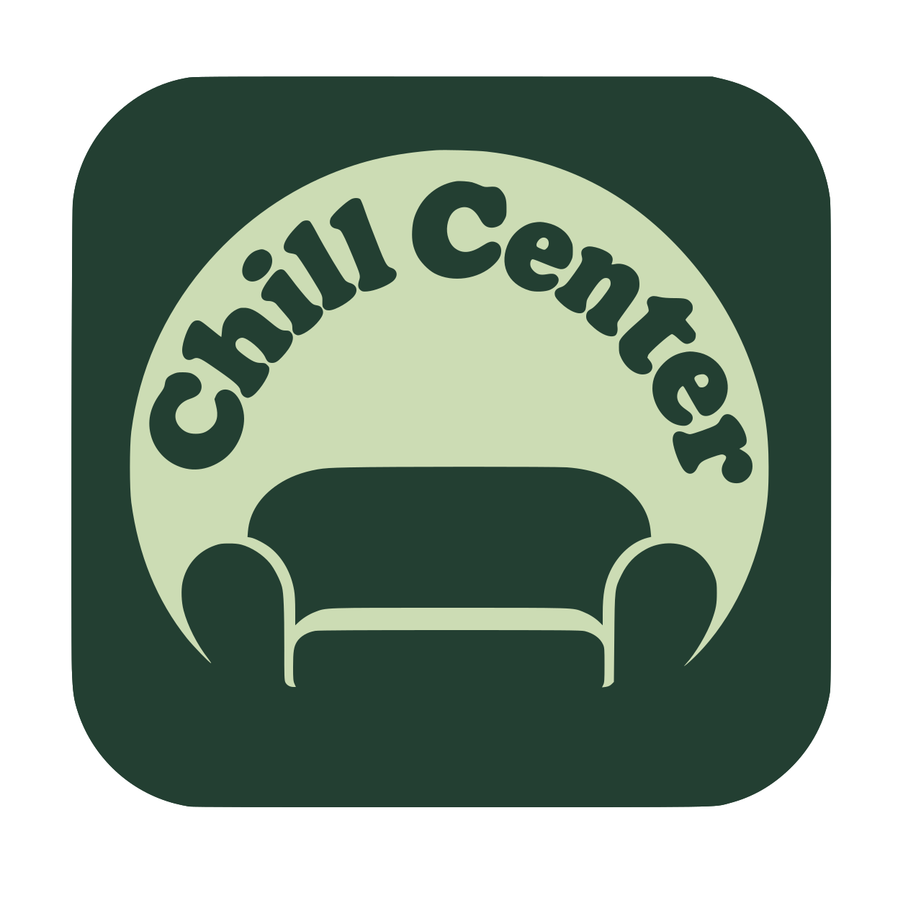
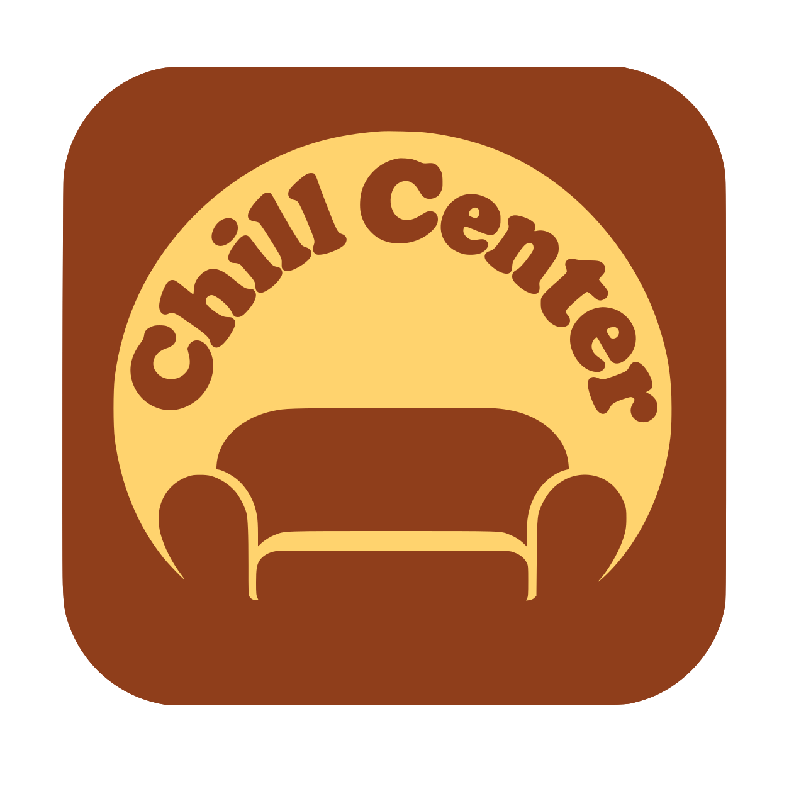
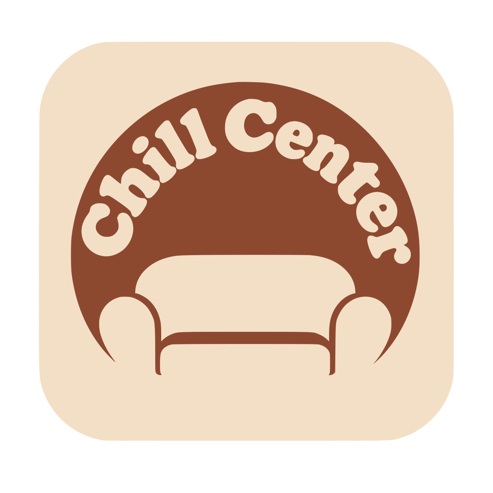
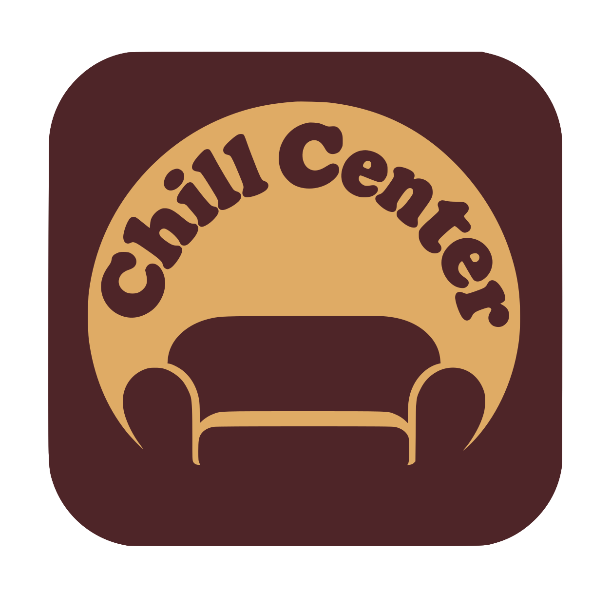
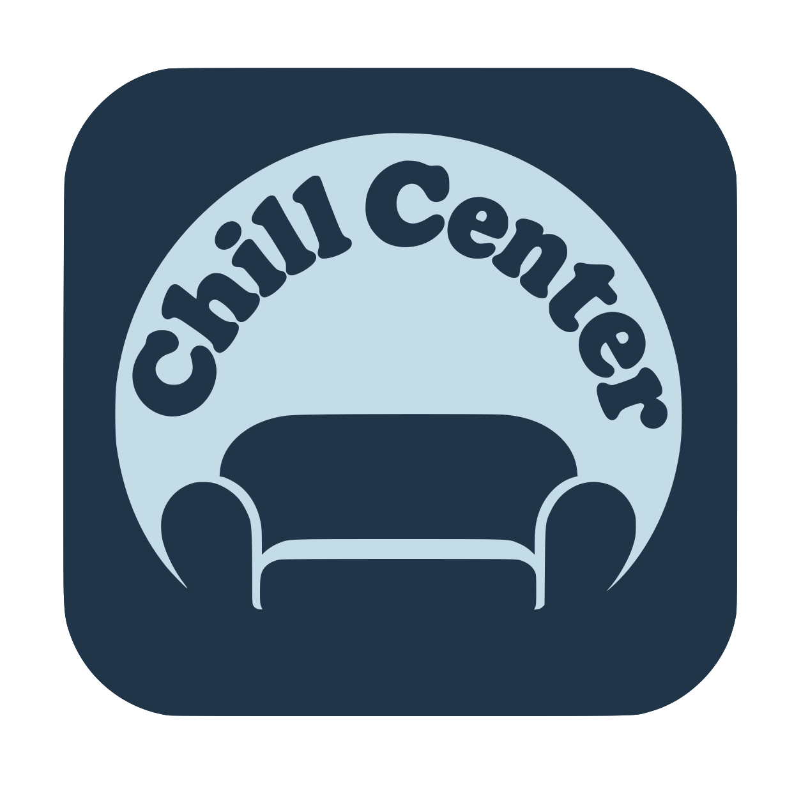
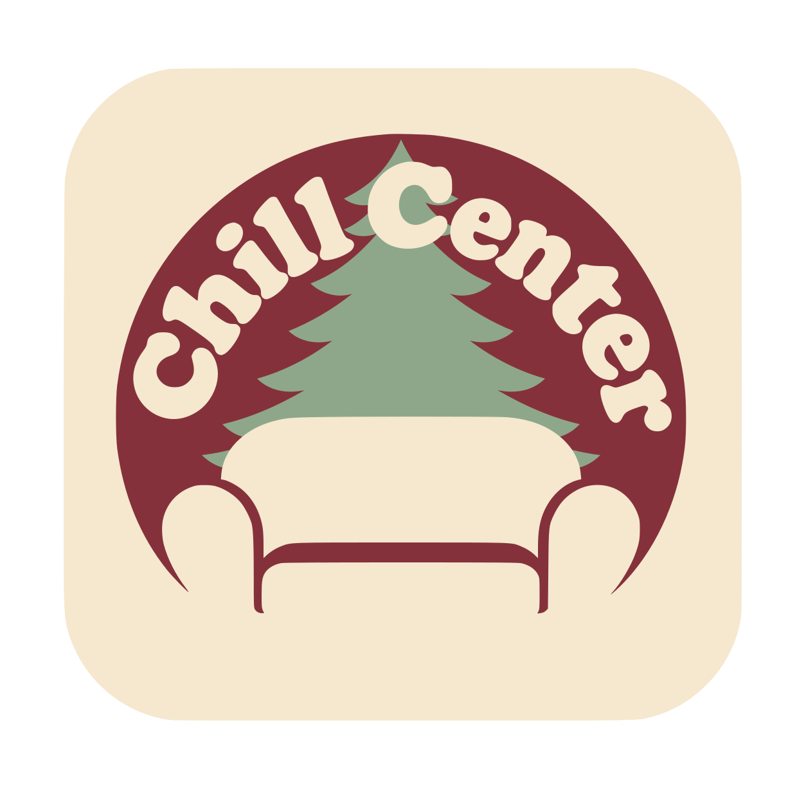
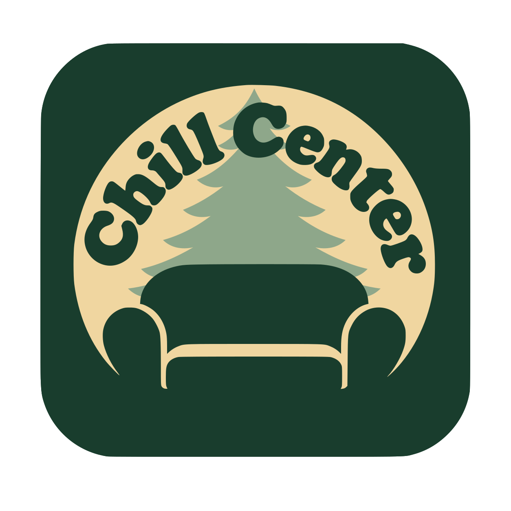
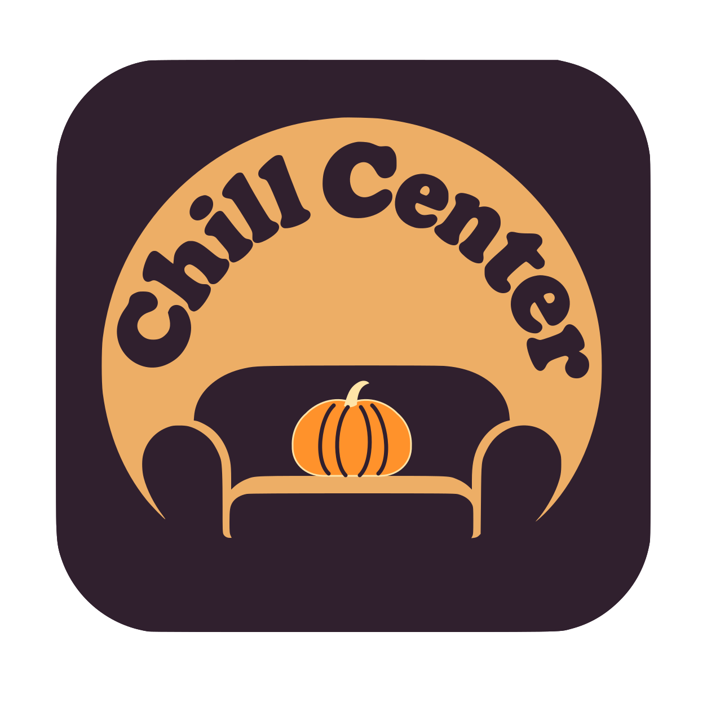

# Logos Chill Center

2026-10-13. Génération et retouches avec l'outil intégré image_gen, sans CLI/API à configurer.

## Logo par défaut approuvé

Choix utilisateur : « oui on garde celui-ci par défaut », corrigé par « le premier des deux ». Il s'agit de **la première proposition de la dernière paire**, avant le second décalage vers le bas : source `exec-df820cb4-e6c6-4ce6-8266-d301ab7fe79d.png`. Pas de `exec-29e960ca…`. Copie originale conservée sans modification dans `default.png`, SHA-256 `45dd0eec618bec968f29c009e9122e74c42081db3bbc462c4bb3176d769b128f`.

## Source SVG commune r4

Méthode autorisée par l'utilisateur : « Oui, créer le gabarit SVG commun ». [master.svg](vector/master.svg) est construit à partir des contours du PNG retenu : tracé unique du carré, du lettrage et du canapé, couleurs unies, contours légèrement lissés. **L'original PNG approuvé reste inchangé ; la nouvelle source vectorielle attend validation visuelle.**

[Générateur Rust](../../scripts/branding.rs), sans dépendance supplémentaire : mêmes définitions et transformations dans les13 SVG autonomes. Le sapin est commun aux deux modes et passe derrière les lettres et le dossier, avec débordement latéral symétrique. La citrouille et ses nervures sont communes aux deux modes et reposent sur l'assise. Seuls palette et motif actif changent ; les écarts d'espacement entre variantes SVG sont supprimés par construction.

[Provenance et preuves](vector/provenance.json) :3 tests Rust PASS, identité des définitions sur13 SVG, XML/références locales, transparence et rendu Chromium hors réseau, inspection des douze variantes. Comparaison du masque de premier plan au PNG d'origine : intersection/union99,63%, pas identité pixel par pixel. Pas de police, image liée, script ou animation dans les SVG. Tracé initial avec [Potrace](https://potrace.sourceforge.net/), utilitaire de développement uniquement, non embarqué dans l'application. Les SVG et la source pèsent environ168KiB sur disque ; pas de gain runtime revendiqué tant que le raccordement n'est pas fait.

Reproduction avec le Rust déjà épinglé du projet : compiler `scripts/branding.rs` avec `rustc --edition=2021`, exécuter le générateur depuis la racine (sortie par défaut `icons/branding/vector`). Le premier argument peut choisir un dossier de sortie. Tests : compiler avec `rustc --edition=2021 --test scripts/branding.rs`, puis exécuter le binaire de test. Faire les modifications de formes uniquement dans `master.svg`, celles des palettes dans le générateur, puis régénérer l'ensemble sur une branche isolée.

Les trois PNG antérieurs àr3 sont aussi copiés dans `raster-r2/`. Le défaut, les neuf PNG non retouchés, les nouvelles propositions raster r3 et tous les historiques Git sont conservés. La galerie présente désormais les SVG r4, avec l'original et le gabarit côte à côte.

## Douze déclinaisons SVG proposées

| Ambiance | Claire | Sombre |
| --- | --- | --- |
| Printemps |  |  |
| Été |  |  |
| Automne |  |  |
| Hiver |  |  |
| Noël |  |  |
| Halloween |  |  |

Palette : sauge/vert pour printemps, sable/ocre pour été, cuivre/bordeaux pour automne, bleu givré/bleu nuit pour hiver. Noël : crème/rouge ou sapin/champagne, avec un sapin sauge derrière le canapé et le lettrage ; Halloween : crème/citrouille ou aubergine/citrouille, avec une citrouille posée sur l'assise. Motifs uniquement pour les événements. Tous gardent le canapé et le lettrage gourmand en arc.

### Retouches r2 demandées par l'utilisateur

Été clair : trace fantôme au centre du disque supprimée. Automne sombre : marque fantôme dans le fond extérieur supprimée. Les défauts étaient visibles directement dans les PNG, indépendamment du navigateur : [BUG-0009](../../docs/debug/BUG-0009-branding-artifacts.md).

Noël clair/sombre : houx remplacé par un sapin qui dépasse du dossier et passe derrière le « C » de Chill Center. Premier essai clair écarté car le sapin s'arrêtait sous les lettres ; une retouche de hauteur conserve la palette claire. Halloween clair/sombre : chauve-souris retirée, citrouille avec tige et nervures posée sur l'assise, devant le dossier. Les six autres déclinaisons et `default.png` restent identiques octet par octet.

Les six fichiers conservent leurs noms ; la galerie utilise `?v=2` sur leurs références pour éviter le cache de la version précédente après rechargement. Anciennes versions et prompts conservés dans la révision `branding-r2` du manifeste et le commit Git `135d78c029cde269434186e4a0b8432962739665`. Les propositions r2 restent à valider visuellement par l'utilisateur.

[Galerie de comparaison](gallery.html) — page locale sans JavaScript, animation, réseau ou service externe.

## Fichiers et provenance

### Retouches r3 : Noël clair, été et contrôle des espacements

Noël clair est désormais dérivé de la géométrie de Noël sombre : les branches du sapin restent derrière les lettres et le dossier, mais dépassent aussi de chaque côté du dossier. La séparation autour des accoudoirs passe d'environ25/26px à20/21px sur la coupe y790 ; le haut du dossier revient de y671 ày647, proche de la référence y648.

Été clair : crème dorée et orange mandarine lumineux. Été sombre : terracotta chaud et miel/ambre. Les deux quittent les bruns précédents, sans ajouter de motif. Palettes demandées et prompts exacts dans le manifeste, révision `branding-r3`.

Les13 PNG (défaut +12 variantes) ont été inspectés ; largeurs/positions des séparations mesurées à trois hauteurs et sur deux coupes de l'assise : [audit avant/après](geometry-audit-r3.json), [BUG-0010](../../docs/debug/BUG-0010-branding-geometry.md). Le décalage principal de Noël clair est corrigé. **Uniformité stricte non acquise dans ces PNG historiques : les mesures résiduelles diffèrent encore de1–4px sur1254px**, soit environ1px au plus à320px. Les coupes ne prouvent pas l'identité de toute la silhouette. L'utilisateur a ensuite autorisé la source commune r4 ci-dessus, qui résout les écarts entre les variantes SVG ; le rapport raster reste conservé.

Défaut et neuf variantes non retouchées conservés octet par octet ; trois références de galerie en `?v=3`. Historique antérieur complet au commit `61f6cd68dae7b2562c4e6d535269f0e0fd8bf2c9` ; les données r2 du manifeste ne sont pas supprimées. Aucun raccordement runtime ou paquet .app modifié.

Treize PNG statiques actuels (logo retenu +12 propositions),1254×1254, canal alpha, plus trois PNG r2 conservés et14 SVG (maître +13 variantes). `manifest.json` référence les fichiers, hashes raster, palettes **demandées** (pas des mesures des pixels), prompts complets et historique des retouches ; le manifeste racine couvre aussi les SVG. Les rendus non retenus restent dans l'historique de génération, identifiés dans le manifeste ; les sources générées ne sont pas supprimées.

Vérification : identité binaire du défaut avec le choix utilisateur ; lecture PNG, dimensions/alpha, hashes et présence des six paires. Inspection visuelle : texte, formes, équilibre clair/sombre, correction de l'outline Noël et marques de fond. Pas de mesure quantitative de contraste, audit d'icône à16px ou vectorisation finale ; ce sont des propositions raster de branding.

## Intégration et limites

Le logo retenu est la référence de marque par défaut ; les déclinaisons attendent validation visuelle. **Ce lot livre les assets, pas le sélecteur d'ambiances de l'application.** L'ancien `icons/icon.png`, le frontend et le paquet .app ne sont pas remplacés ici. Pas de build/déploiement ou push GitHub. Charger seulement la variante active, prévoir les exports d'icône optimisés au raccordement ; ne pas précharger13 images dans la webview.

Règles déjà approuvées, inchangées : saisons Nord aux1mars/juin/septembre/décembre ; Halloween1–31octobre ; Noël25novembre–25décembre ; événements prioritaires, retour saison le lendemain, modes clair/sombre/système indépendants du choix auto/manuel/désactivé. Voir F-20/F-21 et US-032/033. Aucune animation ni règle de calendrier implémentée par une image.

Changement local réversible d'assets, pas de nouvel ADR ou nouvelle dépendance runtime. Les approvals code/test/sécurité du lot interface restent liés à leur SHA ; elles n'approuvent pas ces nouvelles propositions visuelles.
